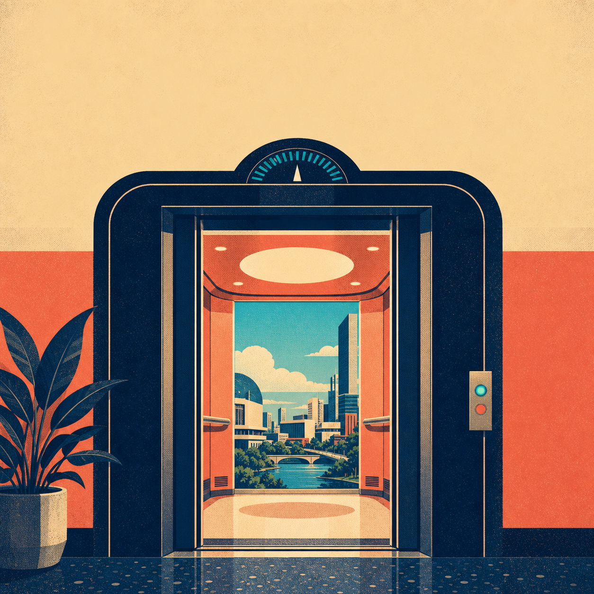

  

    
  

  

    <h2 style="margin-top: 0;">The Next Elevator · 下一部电梯</h2>
    
<em>A Mandarin conversational podcast about the big questions raised by AI.</em>

    
The show steps away from business analysis, technical breakdowns, tool tutorials, and anxiety-driven news. Instead, I invite people from different backgrounds to think aloud about how AI may change work, intelligence, social life, and human relationships—especially where none of us has a settled answer.

    

      <a href="https://podcasts.apple.com/us/podcast/%E4%B8%8B%E4%B8%80%E9%83%A8%E7%94%B5%E6%A2%AF/id6792171887" class="btn">Apple Podcasts</a>
      <a href="https://open.spotify.com/show/033RkM5gOzuZfCSlBO6f3N" class="btn">Spotify</a>
      <a href="https://www.xiaoyuzhoufm.com/" class="btn">小宇宙</a>
    

    
<small>On Xiaoyuzhou, search for <strong lang="zh-CN">下一部电梯</strong>. You can also subscribe through the <a href="https://anchor.fm/s/1150af490/podcast/rss">RSS feed</a>.</small>

  

Latest Episode
==============

### What Keeps Us Going: A Conversation with a Chemistry PhD Student About AI and Meaning

“人只有疯狂地爱上什么，才能维持生命力”：和化学博士聊聊生存危机

*In Mandarin · 1 hr 21 min · November 1, 2026*

In this episode, I speak with 70, a chemistry PhD student and film-photography enthusiast, about what gives creative work and research meaning as AI takes on more of both. We discuss the value of taking a photograph yourself, the boundaries of AI editing, automated laboratories, and whether researchers' experience and judgment remain distinctive. We also talk about finding a sense of worth beyond work, human connection, and why some experiences still require us to pay the “tax of the process.”

<a href="https://podcasts.apple.com/us/podcast/ep08-%E4%BA%BA%E5%8F%AA%E6%9C%89%E7%96%AF%E7%8B%82%E5%9C%B0%E7%88%B1%E4%B8%8A%E4%BB%80%E4%B9%88-%E6%89%8D%E8%83%BD%E7%BB%B4%E6%8C%81%E7%94%9F%E5%91%BD%E5%8A%9B-%E5%92%8C%E5%8C%96%E5%AD%A6%E5%8D%9A%E5%A3%AB%E8%81%8A%E8%81%8A%E7%94%9F%E5%AD%98%E5%8D%B1%E6%9C%BA/id6792171887?i=1000799243194" class="btn btn--small">Listen on Apple Podcasts</a>
<a href="https://open.spotify.com/episode/5t4sWVwsmxVbonFJcLUhue" class="btn btn--small">Listen on Spotify</a>

About the Show
==============

The Next Elevator is not trying to predict the future correctly. It is meant to preserve some room for sincere expression and speculative thinking. We do not pretend to be the most authoritative voices in the room, and we may not reach a standard answer. The aim is simply to take a few large questions about AI seriously while keeping the conversation open, curious, and relaxed.

Across conversations with guests from different fields, I hope to collect distinctive observations, genuine uncertainty, and unusual ideas—and to ask how ordinary people might imagine a world after AI beyond the usual technical and commercial narratives.

Why “The Next Elevator”?
========================

The name is inspired by the “elevator paradox.” Nineteenth-century visions of future skyscrapers anticipated restaurants, barbershops, and stores inside the buildings. Some even imagined that, because moving between floors would be so inconvenient, each level might gradually become a closed society of its own. Science-fiction writers built many possible futures on that premise.

What they missed was the elevator. Once it arrived, every forecast based on the assumption that taller buildings must make daily life less convenient was overturned. One overlooked technical variable made an entire family of imagined futures inaccurate.

AI may play a similar role in society today—and AI itself may still be reshaped by variables we have not yet seen. That is why I am skeptical of confident forecasts, but interested in thinking that remains original, unfixed, and willing to admit uncertainty.
